# Print candidates across dot sizes

The [dithering comparison](dither-comparison.md) tested 24 methods on simulated prints. JJN and Atkinson looked the most stable, and blue-noise threshold noise removed most of their regular patterns. This page compares those six candidates at several dot sizes:

| Method | What it is |
| --- | --- |
| JJN | Jarvis–Judice–Ninke error diffusion, the method preferred in the [physical print test](experiments-xp80t.md) |
| JJN + noise 32 / 64 | JJN with the threshold varied by ±16 / ±32 grey levels by a blue-noise mask (Knox & Eschbach) |
| Atkinson | Atkinson error diffusion: it diffuses only 3/4 of the error, so the darkest and lightest tones print solid |
| Atkinson + noise 32 / 64 | Atkinson with the same threshold noise |

**Everything here is simulated.** None of the noise variants has been printed. The print model is [uncalibrated](dither-comparison.md#simulated-print-uncalibrated), and its tone depends strongly on the assumed dot radius. This page shows which differences hold whatever the real radius is, and which depend on it.

## Radii

The heat model renders each dot as a heat spot. The radius is that of an isolated dot, in dot pitches (1 pitch = 0.125 mm at 203 dpi). Four radii are compared:

- **0.45:** small dots, a light print
- **0.55:** the model default
- **0.65:** roughly tone-neutral for JJN
- **0.75:** strong dot gain, a dark print

## Results

Mean over the eight samples of the [dithering comparison](dither-comparison.md#across-more-samples), against the unadjusted original. Bias is in L\* (positive: the print is lighter); the other columns are explained in the [evaluation method](dither-comparison.md#evaluating-the-simulated-prints). All values are in [candidates.csv](candidates.csv).

| Method | Radius | bias | tone | texture | directional | periodic |
| --- | --- | --- | --- | --- | --- | --- |
| JJN | 0.45 | +24.1 | 7.7 | 5.7 | 0.30 | 0.114 |
| | 0.55 | +12.2 | 3.7 | 5.4 | 0.27 | 0.056 |
| | 0.65 | −0.6 | 2.7 | 6.1 | 0.26 | 0.065 |
| | 0.75 | −11.5 | 6.6 | 6.3 | 0.27 | 0.144 |
| JJN + noise 32 | 0.45 | +24.1 | 7.7 | 5.8 | 0.22 | 0.112 |
| | 0.55 | +12.0 | 3.6 | 5.4 | 0.21 | 0.051 |
| | 0.65 | −1.1 | 2.8 | 6.1 | 0.21 | 0.056 |
| | 0.75 | −12.0 | 6.8 | 6.3 | 0.23 | 0.139 |
| JJN + noise 64 | 0.45 | +24.1 | 7.7 | 5.8 | 0.18 | 0.107 |
| | 0.55 | +11.9 | 3.5 | 5.5 | 0.17 | 0.048 |
| | 0.65 | −1.4 | 2.9 | 6.2 | 0.18 | 0.062 |
| | 0.75 | −12.5 | 7.0 | 6.3 | 0.21 | 0.135 |
| Atkinson | 0.45 | +22.1 | 6.3 | 5.0 | 0.34 | 0.188 |
| | 0.55 | +11.1 | 4.3 | 4.5 | 0.31 | 0.110 |
| | 0.65 | −0.1 | 5.5 | 5.2 | 0.29 | 0.122 |
| | 0.75 | −10.1 | 8.6 | 6.1 | 0.31 | 0.212 |
| Atkinson + noise 32 | 0.45 | +22.3 | 6.3 | 5.1 | 0.30 | 0.178 |
| | 0.55 | +11.2 | 4.0 | 4.7 | 0.25 | 0.101 |
| | 0.65 | −0.3 | 5.4 | 5.4 | 0.24 | 0.103 |
| | 0.75 | −10.4 | 8.5 | 6.2 | 0.27 | 0.198 |
| Atkinson + noise 64 | 0.45 | +22.5 | 6.5 | 5.2 | 0.24 | 0.173 |
| | 0.55 | +11.3 | 3.7 | 4.9 | 0.20 | 0.097 |
| | 0.65 | −0.6 | 5.0 | 5.6 | 0.19 | 0.092 |
| | 0.75 | −11.0 | 8.4 | 6.3 | 0.24 | 0.180 |

## What holds at every radius

- **The dot size matters far more than the method.** Each step of 0.1 in radius shifts the bias by 10–13 L\* for all six candidates; at one radius, the candidates differ by at most 2.5 L\*. Until the real dot size is measured, the print can be lighter or darker than intended whichever method is used. The printer density setting and the preprocessing gamma are the controls for this, not the choice of method.
- **Threshold noise reduces directional patterns at every radius.** With noise 64, JJN's directional score drops by 0.06–0.12 and Atkinson's by 0.07–0.11. Noise 32 gets a little over half of that. In the rocket crop, Atkinson's diagonal lines in the sky are visible at all four radii; with noise 64 they are gone at all four.
- **The cost is small.** Noise 64 raises texture by at most 0.4 and changes tone error by at most 0.6, in either direction.
- **Periodic structure rises at both ends** (0.45 and 0.75) for every candidate. Very small or very large dots make the regular arrangements of error diffusion more visible; the noise variants are slightly lower but follow the same curve.

## What depends on the radius

- **Which family has the better tone.** At the same noise level, JJN has the lower tone error from 0.55 upwards, by a wide margin at 0.65 and above (2.7 against 5.5 at 0.65). Atkinson is better only at 0.45. A likely reason: Atkinson already prints the darkest tones solid, and large dots then also close up the tones next to them, so shadow detail is lost. With small dots, its solid light tones are closer to the original than JJN's sparse, shrunken dots.
- **Whether noise helps tone.** For Atkinson, noise 64 lowers tone error at 0.55–0.75. For JJN, it raises tone error slightly at 0.65–0.75.

## Reading

If the dot size is unknown, **JJN + noise 64** is the safest candidate: its tone error is close to the best at every radius from 0.55 up, and it has the fewest directional patterns of the JJN family. **Atkinson + noise 64** keeps Atkinson's look (solid highlights and shadows) without its diagonal lines, but loses more shadow detail with large dots (tone error 8.4 against 7.0 at 0.75). Plain JJN and Atkinson remain the references to print next to them.

## Sheets

Each sample has two sheets: one row per method, one column per radius.

- **Whole image:** the full print averaged down to 384 pixels wide, roughly how it looks from a normal distance. The red box on the original marks the crop.
- **Crop:** 128×128 dots enlarged 3×, so individual dots are visible.

Jump to: [astronaut](#astronaut) · [sally-ride](#sally-ride) · [earthrise](#earthrise) · [rocket](#rocket) · [coffee](#coffee) · [chelsea](#chelsea) · [camera](#camera) · [patches](#patches)

### astronaut

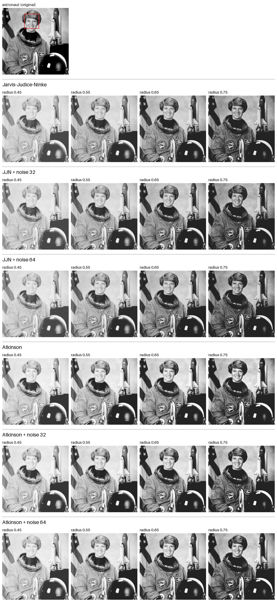

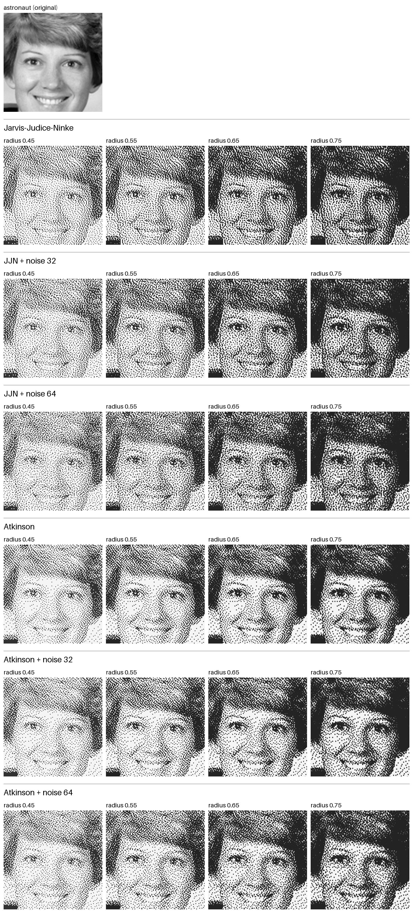

### sally-ride

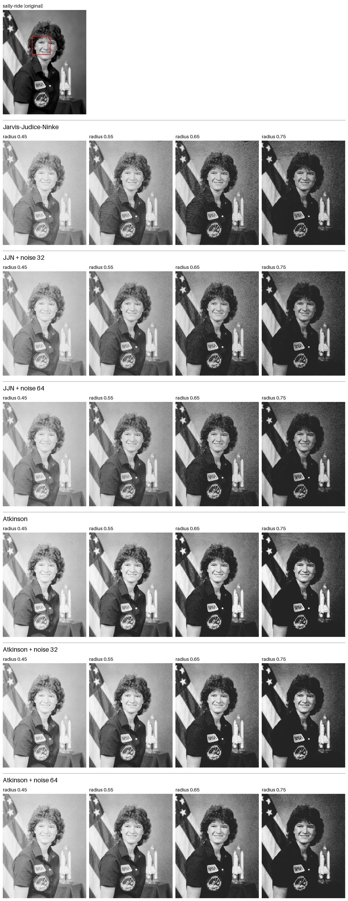

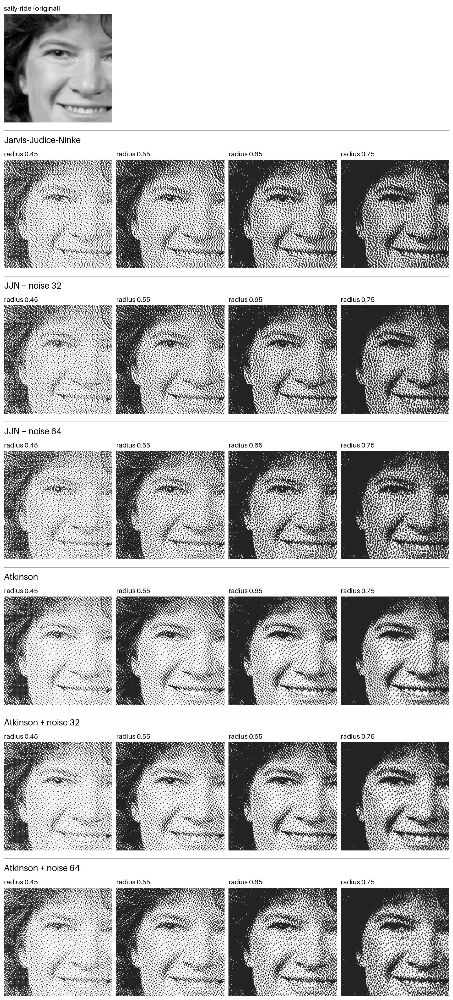

### earthrise

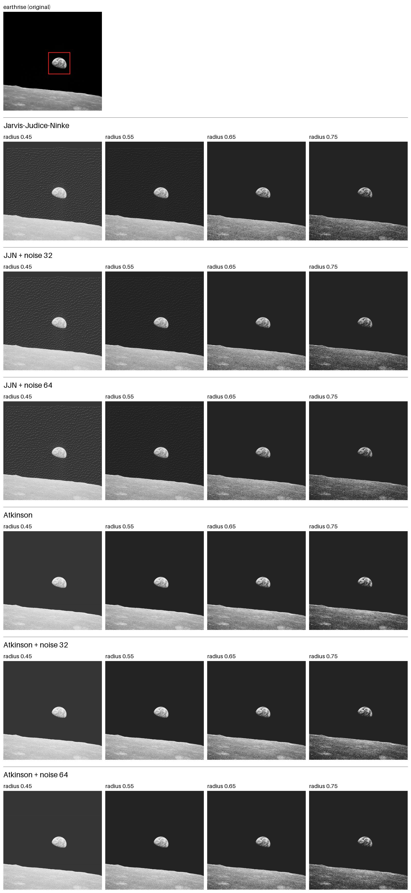

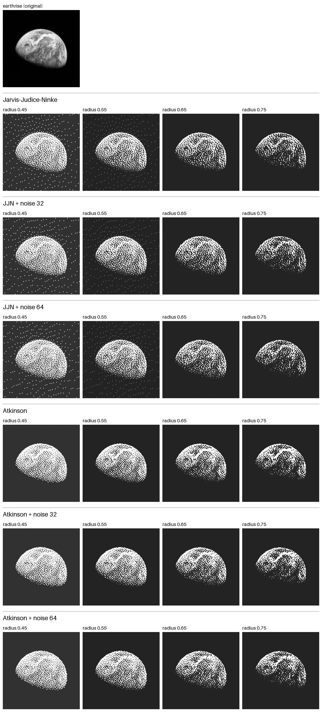

### rocket

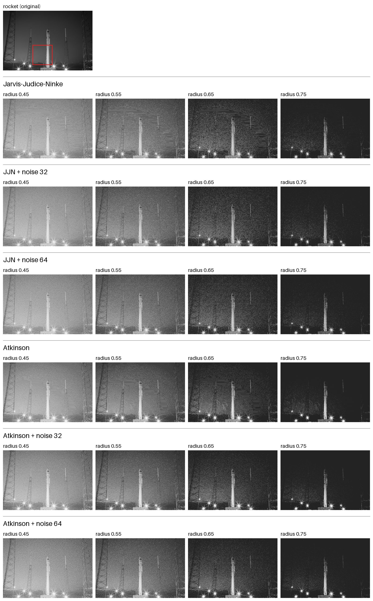

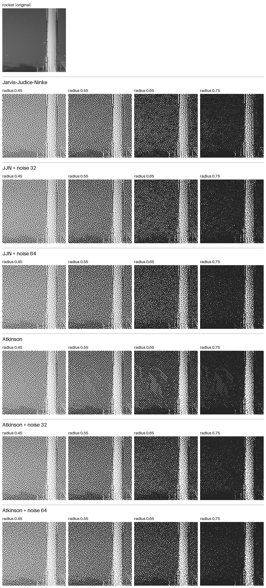

### coffee

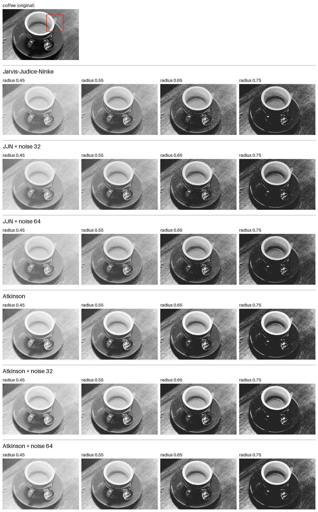

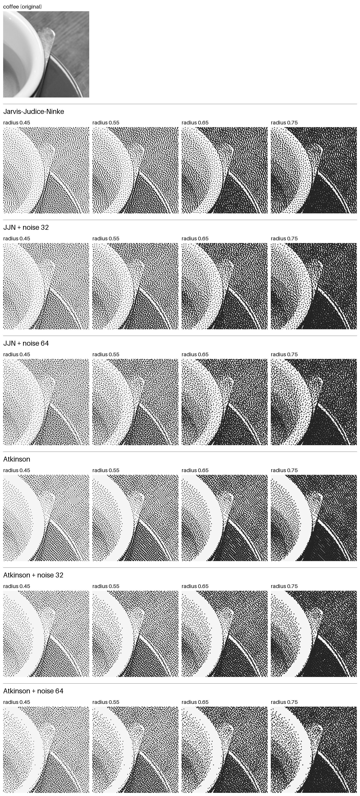

### chelsea

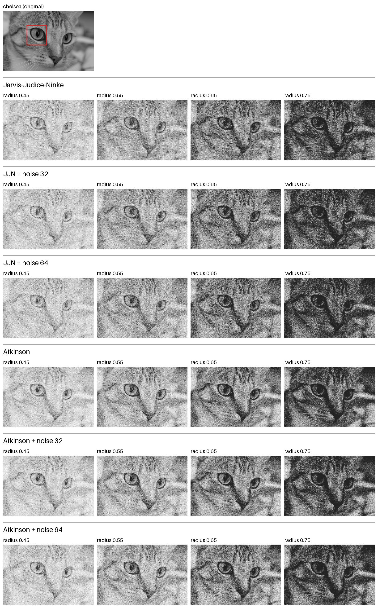

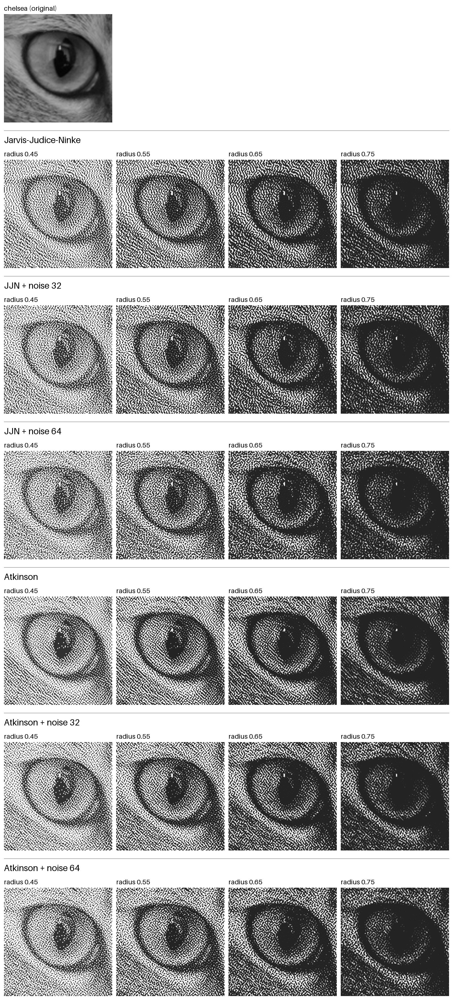

### camera

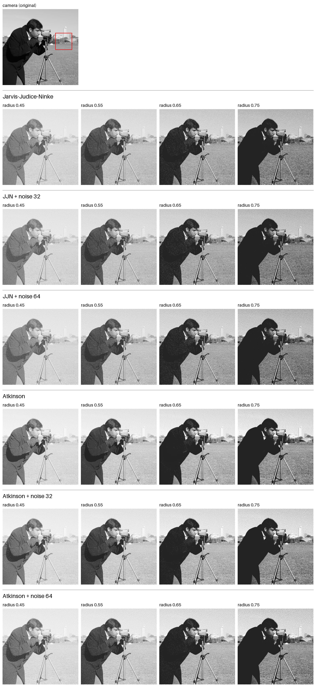

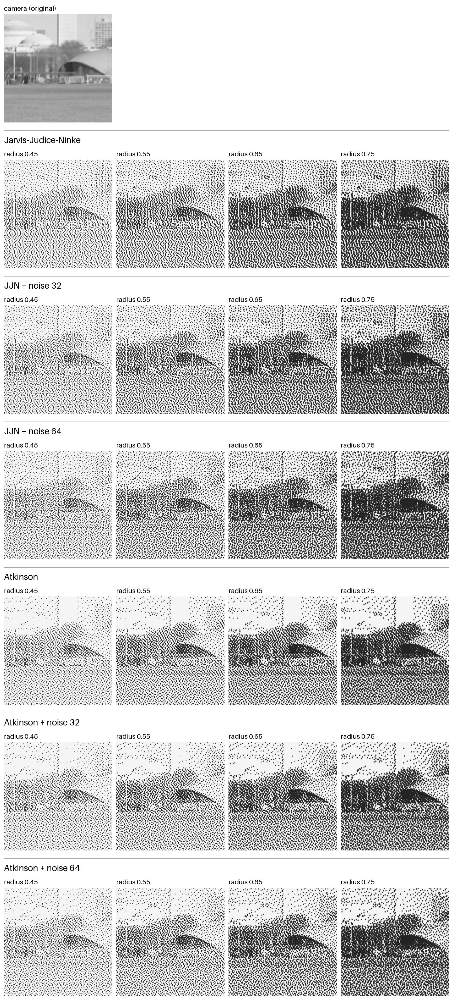

### patches

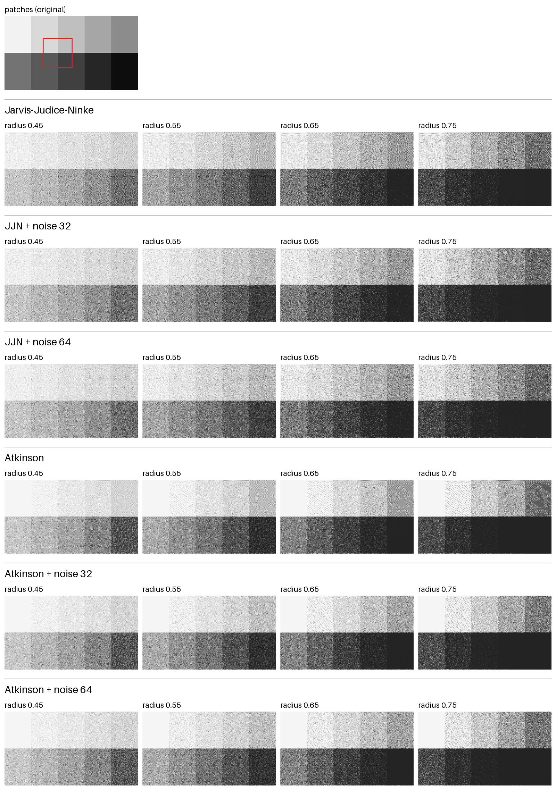

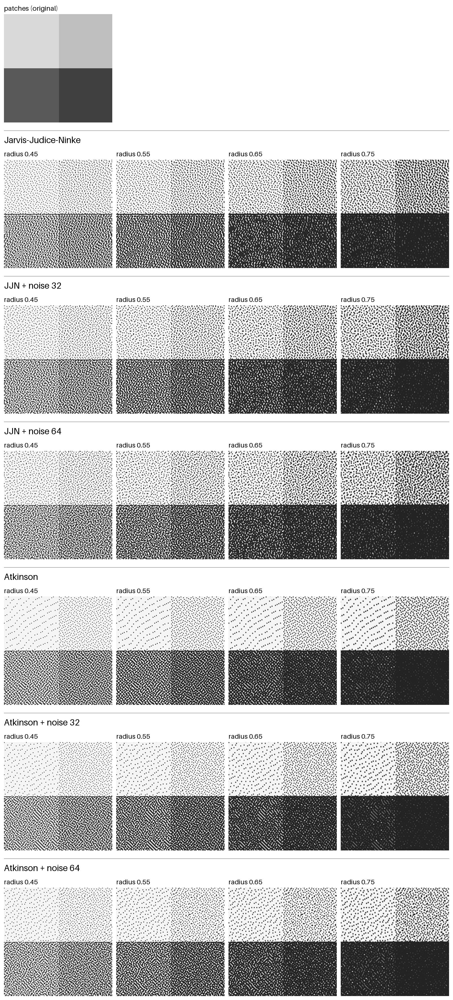

## Reproduce

```bash
python experiments/candidates.py --output docs/images/candidates --csv docs/candidates.csv   # a few minutes
```

The samples are downloaded on first use and checked against pinned SHA-256 hashes; see [`experiments/benchmark.py`](../experiments/benchmark.py) for their sources and licences.
