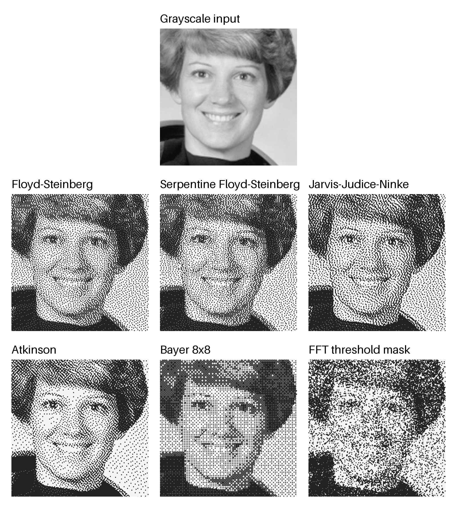

# Dithering comparison (on-screen reference)

These images show what each dithering method does to the same photo after the preprocessing used in the [XP-80T experiment](experiments-xp80t.md). They are **screen previews, not scans of printed receipts**. On paper, dot gain and printer density change the result considerably. In the XP-80T tests the preview that looked best did not always print best. The ranking in the experiment log comes from physical prints of a different (private) portrait.

## Sample image

[`sample/astronaut.png`](sample/astronaut.png): astronaut Eileen Collins, from the NASA Great Images collection (<https://flic.kr/p/r9qvLn>). Released into the public domain with no known copyright restrictions. It was taken from the [scikit-image](https://github.com/scikit-image/scikit-image) sample data. Using it does not imply endorsement by NASA or by the person shown.

The source is 512 px wide and is upscaled to the 576-dot print width before preprocessing.

## Detail view

The crop below is 160×160 dots, enlarged 3× with nearest-neighbour scaling so individual dots stay visible. At normal size, the browser's downscaling blurs dither patterns and makes them hard to compare.


## Full-width results (576 dots)

View each file at 100% zoom. Each one is the exact 1-bit bitmap that would be sent to the printer.

The two right-hand columns come from different sources:

- **This sample (screen preview):** what the previews above show on the NASA sample. Written when this page was created.
- **XP-80T experiment log:** the original observations on a private portrait, copied from [experiments-xp80t.md](experiments-xp80t.md#compared-algorithms). They mix screen previews and physical prints, as recorded there.

| Method | File | This sample (screen preview) | XP-80T experiment log |
| --- | --- | --- | --- |
| Grayscale (input) | [00-grayscale.png](images/astronaut/00-grayscale.png) | After resize, gamma 0.70, contrast 0.90, blur 0.35 px | Same preprocessing |
| Floyd–Steinberg (Pillow) | [floyd.png](images/astronaut/floyd.png) | Fine detail, with directional worm patterns | Detail preserved; conspicuous texture/diagonal patterns on paper |
| Serpentine Floyd–Steinberg | [serpentine.png](images/astronaut/serpentine.png) | Alternating scan direction changes the texture | Different but still noticeable texture |
| Jarvis–Judice–Ninke | [jjn.png](images/astronaut/jjn.png) | Wider error spread, smoother tones | **Best-looking physical print in these comparisons** |
| Atkinson | [atkinson.png](images/astronaut/atkinson.png) | Spreads only 6/8 of the error, so highlights wash out and contrast goes up | Paler, lost some dark detail |
| Bayer 8×8 | [bayer.png](images/astronaut/bayer.png) | Regular cross-hatch grid | Regular grid was conspicuous |
| FFT high-pass threshold mask | [blue.png](images/astronaut/blue.png) | Rough blue-noise approximation; noisy | Poor photographic preview; not a faithful optimized blue-noise algorithm |
| Ostromoukhov | not rendered | — | Softer/less defined when actually printed |
| Zhou–Fang | not rendered | — | Promising PNG preview, but JJN preferred on paper |

Ostromoukhov and Zhou–Fang need an external implementation, so this page has no images for them. See below.

## Simulated print (uncalibrated)

On paper a thermal dot is not a square pixel. `thermal-photo-box simulate` renders a 1-bit image at higher resolution with one of two dot models:

- **`heat` (default):** each fired element deposits a Gaussian heat spot on the paper. Spots from neighbouring dots **add up**, and the paper darkens along a soft threshold of the summed heat. An isolated dot therefore stays small, while the heat tails of adjacent dots fill the gaps between them. This stands in for heat spreading sideways in the paper. Defaults: isolated-dot radius 0.55, threshold 0.4, softness 0.08.
- **`overlap`:** each dot is a hard-edged ellipse and overlapping dots merge (the classic circular dot-overlap model). Default radius 0.75.

In both models the dot is `--aspect` (default 1.15) times taller in the paper-feed direction. Paper and black are grey levels (245 and 35) rather than pure white and black. **All parameters are guesses, not measurements from the XP-80T.** Heat build-up in the print head over successive lines is not modelled.

How the two models treat regular patterns (fraction of area darkened):

| Pattern | heat (r 0.55) | overlap (r 0.75) |
| --- | --- | --- |
| 25%: isolated dots on a 2-dot grid | 0.30 | 0.51 |
| 50%: checkerboard | 0.80 | 0.92 |

The heat model keeps isolated dots near their nominal size but darkens clustered areas strongly. The overlap model enlarges every dot equally.

The same crops as above, rendered with the heat model:



The overlap model is in [detail-simulated-overlap.png](images/astronaut/detail-simulated-overlap.png).

```bash
thermal-photo-box simulate docs/images/astronaut/jjn.png --scale 8            # heat model
thermal-photo-box simulate docs/images/astronaut/jjn.png --model overlap
```

### Does the model reproduce the XP-80T ranking?

`experiments/simulate_sweep.py` simulates each bitmap for a range of isolated-dot radii and compares it with the grayscale target. Both are viewed through a 1.5-dot Gaussian low-pass, as a crude stand-in for viewing distance. It reports two numbers:

- **bias:** mean simulated minus target, in grey levels. Negative means darker.
- **structure:** spread of the remaining difference. Lower is closer to the target.

The NASA sample gave the results below. Ostromoukhov and Zhou–Fang were rendered with a temporary clone of the external implementation; the PNGs are not stored here. Each cell is bias / structure. The lowest structure error per row is in bold, ignoring Atkinson in the lightest row (it is low there only because highlights stay blank).

**Heat model**

| radius | Floyd–Steinberg | Serpentine FS | JJN | Atkinson | Bayer 8×8 | FFT mask | Ostromoukhov | Zhou–Fang |
| --- | --- | --- | --- | --- | --- | --- | --- | --- |
| 0.40 | +26.5 / **8.9** | +26.6 / 9.1 | +25.1 / 9.1 | +25.9 / 5.0 | +27.1 / 9.9 | +24.6 / 13.3 | +26.1 / 9.6 | +24.6 / 10.3 |
| 0.45 | +8.4 / 3.9 | +8.3 / 3.9 | +7.3 / 5.2 | +9.2 / 12.5 | +8.6 / 5.6 | +6.8 / 12.2 | +8.0 / **3.7** | +6.1 / 4.2 |
| 0.50 | −6.3 / 7.0 | −6.5 / 7.0 | −5.6 / 7.0 | −1.3 / 15.1 | −7.7 / 9.0 | −5.7 / 13.7 | −6.2 / 5.9 | −8.1 / **5.8** |
| 0.55 | −21.9 / 13.9 | −22.3 / 14.1 | −18.7 / 11.2 | −11.7 / 18.6 | −25.4 / 18.0 | −18.3 / 16.6 | −21.2 / 11.7 | −22.8 / **11.1** |
| 0.60 | −36.1 / 19.9 | −36.7 / 20.3 | −31.3 / **15.9** | −21.8 / 22.7 | −40.6 / 24.7 | −30.3 / 20.3 | −35.4 / 17.3 | −37.1 / 16.5 |
| 0.65 | −48.2 / 24.1 | −48.7 / 24.4 | −42.2 / **20.2** | −31.2 / 26.5 | −51.9 / 27.5 | −40.9 / 23.8 | −47.6 / 22.0 | −49.8 / 21.5 |
| 0.70 | −60.1 / 28.8 | −60.3 / 28.8 | −52.8 / **24.6** | −40.7 / 30.5 | −62.0 / 29.9 | −50.8 / 27.5 | −59.6 / 27.1 | −62.3 / 26.9 |

**Overlap model**

| radius | Floyd–Steinberg | Serpentine FS | JJN | Atkinson | Bayer 8×8 | FFT mask | Ostromoukhov | Zhou–Fang |
| --- | --- | --- | --- | --- | --- | --- | --- | --- |
| 0.50 | +11.9 / **8.2** | +11.8 / 8.4 | +12.1 / 8.8 | +14.7 / 5.3 | +11.4 / 9.1 | +12.0 / 13.5 | +11.9 / 9.1 | +10.2 / 10.0 |
| 0.60 | −14.6 / 7.4 | −14.8 / 7.7 | −12.2 / 7.5 | −7.3 / 12.6 | −16.6 / 9.9 | −11.9 / 14.0 | −13.9 / **7.0** | −16.0 / 7.5 |
| 0.71 | −37.4 / 15.7 | −37.8 / 16.0 | −32.0 / **13.5** | −24.0 / 18.0 | −40.9 / 19.2 | −30.7 / 18.4 | −36.0 / 14.4 | −38.4 / 14.5 |
| 0.80 | −54.7 / 22.5 | −55.1 / 22.8 | −47.1 / **19.2** | −37.1 / 23.3 | −58.7 / 25.9 | −45.1 / 23.0 | −53.0 / 21.0 | −55.8 / 21.3 |
| 0.90 | −69.9 / 29.4 | −70.2 / 29.5 | −60.7 / **24.9** | −49.7 / 28.6 | −73.0 / 31.6 | −58.2 / 27.9 | −67.9 / 27.8 | −71.6 / 28.8 |
| 1.00 | −85.0 / 37.9 | −84.8 / 37.7 | −74.8 / **32.0** | −62.9 / 35.1 | −85.2 / 38.2 | −70.8 / 33.4 | −83.0 / 36.1 | −86.9 / 37.6 |

Reading:

- Both models agree on the overall pattern. With little dot gain, Floyd–Steinberg, Ostromoukhov and Zhou–Fang are as good as or better than JJN, which matches how promising they looked on screen. Once gain is strong, JJN has the lowest structure error and darkens less than all three. This matches the XP-80T paper result.
- **Heat model:** JJN's lead over Floyd–Steinberg stays clear. Its lead over Zhou–Fang and Ostromoukhov in structure error is small (for example 15.9 vs 16.5 at radius 0.60), and Zhou–Fang is slightly ahead at 0.55. JJN's clearer advantage is tone: it comes out 5–10 grey levels lighter. In this model the paper result is explained mostly by darkening rather than by texture.
- Every method prints darker than the target once dots interact. The gamma 0.70 brightening in the preprocessing can be read as a manual compensation for this.
- Atkinson darkens least because it discards a quarter of the error, but its structure error is never the lowest. That is consistent with the log's "paler, lost some dark detail".

Limits: one sample image, uncalibrated parameters and a crude metric. Bias and structure are not independent, because darkening compresses contrast. The agreement suggests the models point the right way; it does not validate them. The next step would be to fit radius, threshold and aspect to a printed test chart.

## Reproduce

```bash
pip install -e .
python experiments/compare_dither.py docs/sample/astronaut.png \
  --output docs/images/astronaut --detail 180 60 160 --simulate
cd docs/images/astronaut && python ../../../experiments/simulate_sweep.py 00-grayscale.png \
  floyd.png serpentine.png jjn.png atkinson.png bayer.png blue.png               # heat model
#   add --model overlap --radii 0.5 0.6 0.71 0.8 0.9 1.0 for the overlap table
```

To print the same set on a connected XP-80T, add `--print`. Add `--density N` only if you accept that the experimental density command may change persistent printer settings (see the README caution).

`experiments/compare_structure_aware.py` compares JJN with Ostromoukhov and Zhou–Fang through a local clone of [dalpil/structure-aware-dithering](https://github.com/dalpil/structure-aware-dithering), which is not vendored here:

```bash
python experiments/compare_structure_aware.py --repo /path/to/structure-aware-dithering \
  --input docs/images/astronaut --output output/structure-aware
```
