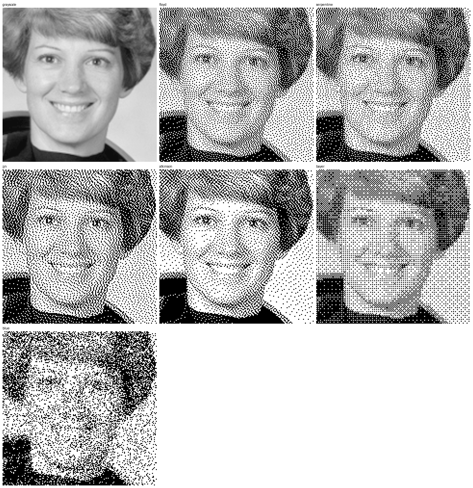

# Dithering comparison (on-screen reference)

These images show what each dithering method does to the same photo after the preprocessing used in the [XP-80T experiment](experiments-xp80t.md). They are **screen previews, not scans of printed receipts**. On paper, dot gain and printer density change the result considerably. In the XP-80T tests the preview that looked best did not always print best. The ranking in the experiment log comes from physical prints of a different (private) portrait.

## Sample image

[`sample/astronaut.png`](sample/astronaut.png): astronaut Eileen Collins, from the NASA Great Images collection (<https://flic.kr/p/r9qvLn>). Released into the public domain with no known copyright restrictions. It was taken from the [scikit-image](https://github.com/scikit-image/scikit-image) sample data. Using it does not imply endorsement by NASA or by the person shown.

The source is 512 px wide and is upscaled to the 576-dot print width before preprocessing.

## Detail view

The crop below is 160×160 dots, enlarged 3× with nearest-neighbour scaling so individual dots stay visible. At normal size, the browser's downscaling blurs dither patterns and makes them hard to compare.



## Full-width results (576 dots)

View each file at 100% zoom. Each one is the exact 1-bit bitmap that would be sent to the printer.

The two right-hand columns come from different sources:

- **This sample (screen preview):** what the previews above show on the NASA sample. Written when this page was created.
- **XP-80T experiment log:** the original observations on a private portrait, copied from [experiments-xp80t.md](experiments-xp80t.md#compared-algorithms). They mix screen previews and physical prints, as recorded there.

| Method | File | This sample (screen preview) | XP-80T experiment log |
| --- | --- | --- | --- |
| Grayscale (input) | [00-grayscale.png](images/astronaut/00-grayscale.png) | After resize, gamma 0.70, contrast 0.90, blur 0.35 px | Same preprocessing |
| Floyd–Steinberg (Pillow) | [floyd.png](images/astronaut/floyd.png) | Fine detail, with directional worm patterns | Detail preserved; conspicuous texture/diagonal patterns on paper |
| Serpentine Floyd–Steinberg | [serpentine.png](images/astronaut/serpentine.png) | Alternating scan direction changes the texture | Different but still noticeable texture |
| Jarvis–Judice–Ninke | [jjn.png](images/astronaut/jjn.png) | Wider error spread, smoother tones | **Best-looking physical print in these comparisons** |
| Atkinson | [atkinson.png](images/astronaut/atkinson.png) | Spreads only 6/8 of the error, so highlights wash out and contrast goes up | Paler, lost some dark detail |
| Bayer 8×8 | [bayer.png](images/astronaut/bayer.png) | Regular cross-hatch grid | Regular grid was conspicuous |
| FFT high-pass threshold mask | [blue.png](images/astronaut/blue.png) | Rough blue-noise approximation; noisy | Poor photographic preview; not a faithful optimized blue-noise algorithm |
| Ostromoukhov | not rendered | — | Softer/less defined when actually printed |
| Zhou–Fang | not rendered | — | Promising PNG preview, but JJN preferred on paper |

Ostromoukhov and Zhou–Fang need an external implementation, so this page has no images for them. See below.

## Reproduce

```bash
pip install -e .
python experiments/compare_dither.py docs/sample/astronaut.png \
  --output docs/images/astronaut --detail 180 60 160
```

To print the same set on a connected XP-80T, add `--print`. Add `--density N` only if you accept that the experimental density command may change persistent printer settings (see the README caution).

`experiments/compare_structure_aware.py` compares JJN with Ostromoukhov and Zhou–Fang through a local clone of [dalpil/structure-aware-dithering](https://github.com/dalpil/structure-aware-dithering), which is not vendored here:

```bash
python experiments/compare_structure_aware.py --repo /path/to/structure-aware-dithering \
  --input docs/images/astronaut --output output/structure-aware
```
