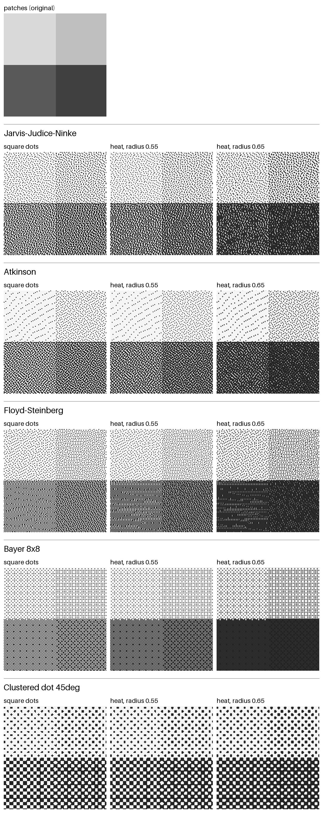
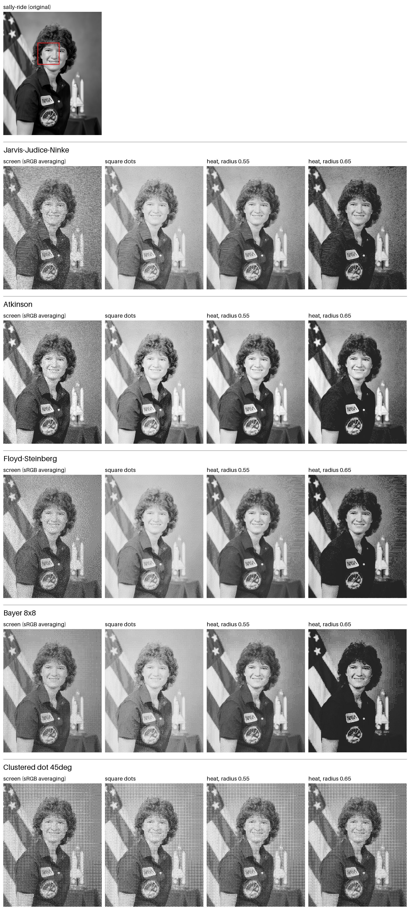
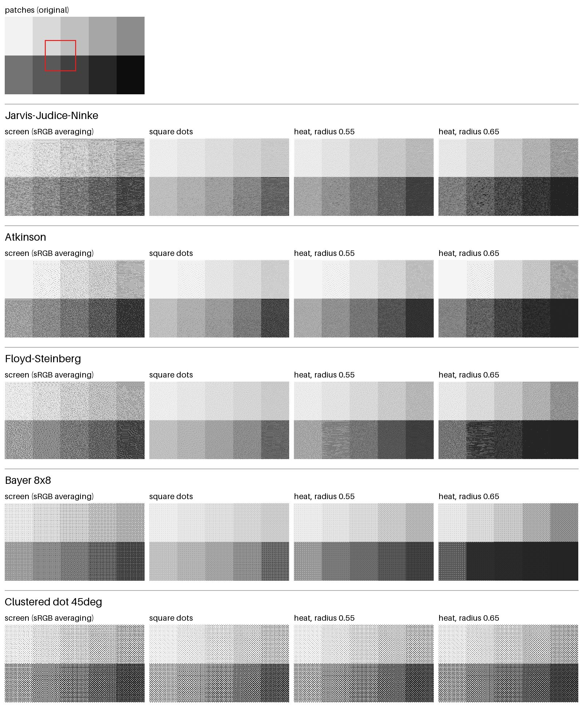
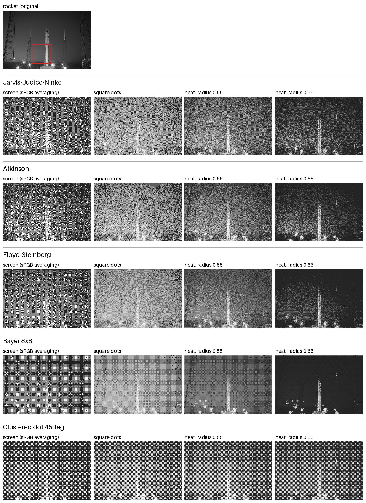
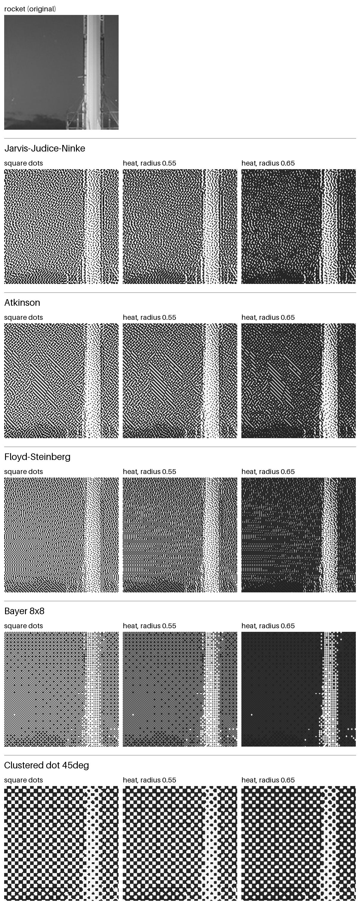
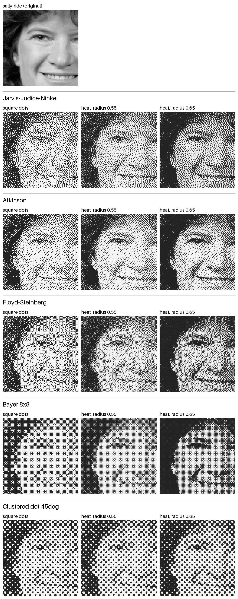

# What a square-pixel preview hides

A 1-bit image on screen draws every dot as a filled square. On thermal paper the dots are round, spread, and merge with their neighbours. This page compares the plain on-screen view with the [simulated print](dither-comparison.md#simulated-print-uncalibrated) to show where the screen misleads. The print model is uncalibrated, so read the print columns as "what kind of difference", not as exact values.

Four renderings are compared:

| Rendering | What it is |
| --- | --- |
| screen (sRGB averaging) | the bitmap scaled down the way most image viewers and browsers do it: grey values are averaged without converting to linear light |
| square dots | each dot fills its cell exactly, mixed in linear light (`--model square`). This is what perfect square dots on paper would look like |
| heat, radius 0.55 / 0.65 | the heat print model: round dots whose heat adds up between neighbours |

## Tone: the screen is right by accident

Flat grey levels dithered with JJN, apparent lightness in L\* (paper and ink grey levels as in the print model; "ink" is the developed, dark area of the thermal paper):

| Grey | Target | Screen (sRGB averaging) | Square dots | Heat 0.55 | Heat 0.65 |
| --- | --- | --- | --- | --- | --- |
| 16 | 17.6 | 19.4 | 32.4 | 20.5 | 13.8 |
| 48 | 30.2 | 31.5 | 50.1 | 32.4 | 16.1 |
| 96 | 47.4 | 47.6 | 66.0 | 52.0 | 30.6 |
| 128 | 58.1 | 58.3 | 74.0 | 62.9 | 45.9 |
| 160 | 68.3 | 68.5 | 80.7 | 74.4 | 62.9 |
| 208 | 82.9 | 83.1 | 89.3 | 87.5 | 83.0 |
| 240 | 92.2 | 92.7 | 94.3 | 93.9 | 92.8 |

- **The screen matches the target almost exactly.** Error diffusion spreads the error in grey values, and the viewer averages the same grey values back. The two make the same assumption, so they agree.
- **But light does not mix in grey values.** Perfect square dots, mixed as light actually mixes, would print much lighter: 16 L\* lighter at mid-grey. Half the area inked reflects about half the light, which looks much lighter than grey 128.
- **Dot gain pushes it back.** Real dots spread and merge, which darkens the print. In the model, radius 0.55 lands close to the target, and 0.65 overshoots into a dark print.

So the screen shows the right tone only because two errors cancel: the dithering ignores linear light, and the printer's dot gain happens to compensate. How well they cancel depends on the real dot size, which the screen cannot show. Over the eight samples, the square model is 17–21 L\* lighter than the original for every method ([square.csv](square.csv)), while the heat model is 8–14 L\* lighter at radius 0.55, and at 0.65 ranges from 9 L\* darker to 10 L\* lighter depending on the method (close to zero for JJN and Atkinson; [benchmark.csv](benchmark.csv)).

## Shape: dots merge on paper

Enlarged crops of the patch chart: square dots on the left, simulated prints on the right.



- **Light tones look the same.** Isolated dots do not touch, so a square and a round dot read the same. Atkinson's diagonal lines in the light patches are equally visible in both.
- **Dark tones change most.** On screen, the white gaps between dots are clean squares. On paper the heat of the surrounding dots closes them: JJN's mid-dark maze becomes thick blobs, Floyd–Steinberg's regular rows turn into short white dashes, and Bayer's dark patches go almost solid at radius 0.65. A dark-tone pattern that looks harmless on screen can look quite different on paper.
- **Clustered dots change least.** The 45° screen keeps its shape: each cluster just grows a little. That is why newspapers use clustered dots on presses with variable dot gain.

## Scaling on screen adds its own patterns

The whole-image sheets show a third problem. A 576-dot-wide bitmap shown at 384 pixels is scaled by 1.5, which is not a whole number. The viewer then mixes neighbouring dots unevenly and draws grain and moiré that are neither in the bitmap nor on paper (left column below; most visible for Bayer and the clustered screen). Judge a bitmap on screen only at 100%, 200% or another whole-number zoom, or through a correct linear downscale like the other columns.



## More sheets









## Reproduce

```bash
python experiments/square_preview.py --output docs/images/square --csv docs/square.csv
thermal-photo-box simulate output/jjn.png --model square   # one bitmap as square dots
```
